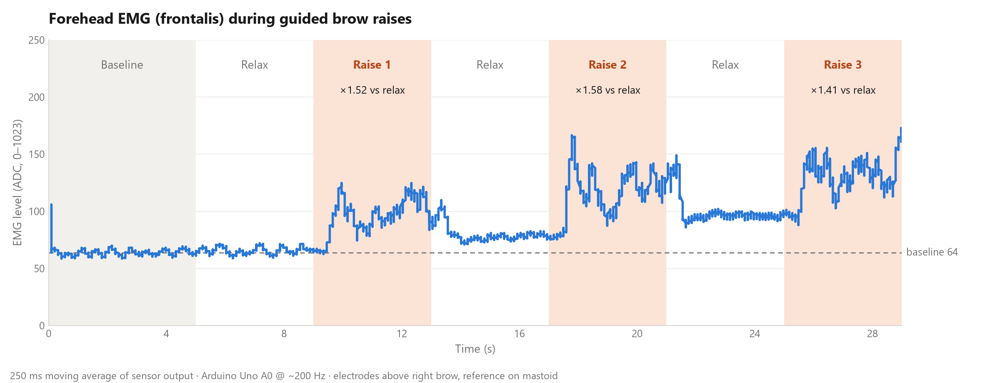

# MyoMask · Facial EMG Experiment

Code and data behind the sensor test in my MyoMask portfolio project: which facial muscles tell expressions apart, measured with a single-channel EMG sensor, an Arduino Uno and a Python recorder. Everything here was built, coded and recorded by me.


## Results

Activation score = (median signal during the expression − median at rest) ÷ robust SD at rest.

| Site | Muscle | Pucker lips | Squeeze eyes | Raise eyebrows |
|---|---|---:|---:|---:|
| Forehead | Frontalis | +0.4 | −0.5 | **+3.9** |
| Eye corner | Orbicularis oculi | +0.1 | +0.8 | −0.4 |
| Mouth corner | Orbicularis oris | **+1.6** | **+1.6** | +0.2 |

- The forehead responds selectively to raising the eyebrows (clearest result).
- The mouth corner responds to puckering and to squeezing the eyes (squeezing also tenses the cheeks and upper lip).
- The eye corner shows short peaks only; the weak score reflects motion artifacts on thin, mobile skin.

**Limits:** one participant (me), one channel, two rounds per site. The scores are indicative, not statistical.


## Gen 1 bench test: brow raise on video

Before building the sensor into a mask, I checked that one forehead channel reliably sees a brow raise. The Arduino stays on the desk; two electrodes sit above the right brow about 2.5 cm apart, the reference behind the ear.

**[▶ Watch the test video](https://cdn.jsdelivr.net/gh/JerryWu777/MyoMask-EMG@main/results/gen1/gen1_brow_raise_test.mp4)** (webcam and live EMG in one frame, 30 s)



**Protocol:** rest 5 s (baseline), then (relax 4 s, raise eyebrows 4 s) × 3 rounds, cued by beeps.

| Round | Relax (mean) | Raise (mean) | Raise ÷ relax |
|---|---:|---:|---:|
| 1 | 66 | 100 | ×1.52 |
| 2 | 77 | 122 | ×1.58 |
| 3 | 96 | 135 | ×1.41 |

Every raise was higher than the relax before it. The key fix was unplugging the laptop charger: with it plugged in, 50 Hz mains noise coupled through the electrodes and saturated the ADC at 1023.

## Setup

- EMG sensor board, single channel, ±9 V from two 9 V batteries; SIG → Arduino A0, GND → Arduino GND
- 3 surface electrodes per site: MID and END on the muscle, REF on bone behind the ear
- Arduino Uno reads A0 at about 240 Hz and streams over USB serial (115200 baud)
- Python gives voice cues, records the signal to CSV, scores each expression and plots it


**Protocol per site:** rest 5 s, then (pucker lips 4 s, rest 4 s, squeeze eyes 4 s, rest 4 s, raise eyebrows 4 s, rest 4 s) × 2 rounds. Sites are tested one at a time.

## Files

| Path | What it is |
|---|---|
| `code/EMG_6ch_fix.ino` | Arduino sketch: reads A0–A5 (with a settling read) and prints them over serial |
| `code/emg_site_en.py` | Recorder: voice cues, serial capture, CSV, activation scores, plots |
| `code/emg_avatar_demo.py` | Avatar test: turns the forehead score into an avatar expression (live, simulated or replaying a CSV) |
| `code/workflow_diagram.py` | Draws the workflow diagram |
| `code/emg_record_gen1.py` | Gen 1 recorder: webcam and live EMG curve in one video, beep-cued brow raise test, CSV log |
| `data/gen1_brow_raise_213902.csv` | Gen 1 brow raise recording: time, raw A0, smoothed, phase |
| `results/gen1/` | Gen 1 test video and chart |
| `data/*.csv` | Raw recordings, one per site: time in seconds, A0 value 0–1023 |
| `results/*.png` | Summary chart, waveforms of all sites, one figure per site |

## Run it

```bash
pip install -r requirements.txt
python code/emg_site_en.py forehead --port COM4   # record one site (forehead / eye / mouth)
python code/emg_site_en.py compare                # compare the latest recording of every site
python code/emg_avatar_demo.py --replay           # replay data/forehead_134856.csv into the avatar
python code/emg_record_gen1.py --auto 8           # Gen 1: guided brow raise test, saves video + CSV
```

Close the Arduino IDE Serial Monitor first so the port is free.

**Safety note:** connect the two 9 V batteries as +9 V / GND / −9 V exactly as marked on the sensor board. Reversing them burned one of my boards during the Gen 2 test.
